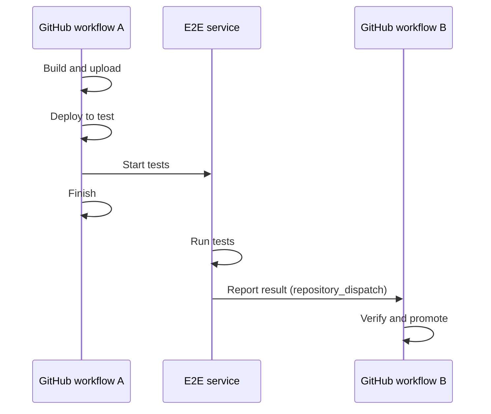

# Continuing a GitHub Actions Deployment After Long-Running E2E Tests

*2026-11-14*

**In short:**

- A GitHub job that only *launches* external E2E tests cannot wait for them, and holding a runner open to poll is wasteful.
- Instead, finish the first workflow and have the test service send a `repository_dispatch` event when the tests complete. That starts a second workflow, which promotes the release.
- Identify the release with an immutable manifest in a bucket, and register it before launching the tests.
- Treat the event as a hint, not proof. Verify the result, the assets, and that this is still the current candidate before promoting, and make promotion idempotent.

A deployment pipeline builds a release, puts its assets in a bucket, deploys them to a test environment, and starts end-to-end tests. The tests run on an external service and take a long time. When they pass, we want to promote the same release to the next environment.

If the action that starts the tests returns immediately, a later job with `needs: e2e` only waits for the launch. It does not wait for the external tests. We can keep a runner alive to poll for the result, but there is another option: finish the first workflow and have the test service start a second one when the result is ready.



The handoff uses GitHub's [`repository_dispatch` event](https://docs.github.com/en/actions/reference/workflows-and-actions/events-that-trigger-workflows#repository_dispatch). The second workflow is a new run, not a resumed job in the first one. Note that a successful first run means only that the tests were *started*, not that they passed.

## A manifest identifies the release

The build already writes a manifest to the bucket. It can describe the release without copying the assets into GitHub Actions artifacts:

```json
{
  "release_id": "123456789-1",
  "commit_sha": "abc123...",
  "origin_run_id": "123456789",
  "origin_run_attempt": "1",
  "assets": [
    {
      "uri": "s3://example-builds/releases/123456789-1/app.tar.gz",
      "sha256": "..."
    }
  ]
}
```

The bucket and names are examples; the pattern works with other object stores. Use a unique location for each build and make the manifest and its assets immutable, or record exact object versions and checksums and verify them when reading. A pointer such as `latest/manifest.json` is not enough: it could refer to a different release by the time the tests finish.

Before starting E2E, workflow A uploads the manifest, deploys its assets to the test environment, and registers a release record that binds the manifest handle to the GitHub run and the E2E request. The record can live in a database or in the test service if it supports the necessary lookup. It gives the continuation a trusted way to check what the callback refers to.

Pass the manifest handle and a unique correlation ID when starting the tests. If the service returns its own test run ID, record that too. Make the manifest and correlation record available before a completion callback can arrive, so that a very fast test cannot outrun registration. For example, preassign the correlation ID and register it before the launch request, then have the callback carry it along with the service's test run ID.

## Send a completion event

When the tests finish, a trusted adapter (see [Who sends the dispatch](#who-sends-the-dispatch)) sends the result to GitHub. The request looks like this; the test service itself does not make it:

```bash
curl --fail-with-body --request POST \
  "https://api.github.com/repos/OWNER/REPO/dispatches" \
  --header "Accept: application/vnd.github+json" \
  --header "Authorization: Bearer $INSTALLATION_TOKEN" \
  --header "Content-Type: application/json" \
  --data '{
    "event_type": "e2e_completed",
    "client_payload": {
      "result": "passed",
      "manifest_uri": "s3://example-builds/releases/123456789-1/manifest.json",
      "correlation_id": "123456789-1",
      "test_run_id": "e2e-98765",
      "results_url": "https://tests.example.com/runs/e2e-98765",
      "origin_run_id": "123456789"
    }
  }'
```

The values are examples; the adapter fills them in from the verified run, not from the test service's request. GitHub returns HTTP 204 when it accepts the event. That is not confirmation that deployment succeeded. See [Create a repository dispatch event](https://docs.github.com/en/rest/repos/repos#create-a-repository-dispatch-event).

The adapter needs a credential authorized for the repository. A GitHub App installation token, minted per request, is the recommended option; GitHub specifies **Contents: write** for a fine-grained token used with this endpoint. The original job's `GITHUB_TOKEN` expires when that job finishes, so it cannot be saved for a callback that happens later. See [GitHub's token lifetime documentation](https://docs.github.com/en/actions/concepts/security/github_token).

## Who sends the dispatch

Avoid giving the dispatch credential to the test runner. Anyone holding it can send `e2e_completed` with any payload, including `"result": "passed"`, and test runners often execute code from the release under test. Put the credential in a small trusted adapter instead, for example a Lambda function behind a Function URL. The E2E service calls the adapter, and the adapter calls GitHub.

Setup:

- Create a GitHub App with only **Contents: write** and install it on this one repository.
- Store the App's private key in a secrets manager, readable only by the adapter's role. The App ID and installation ID are not secret.

On each request, the adapter:

1. **Authenticates the caller**, for example by checking the E2E service's webhook signature or a shared secret. It rejects anything else.
2. **Fetches the facts instead of trusting the body.** It takes the test run ID from the request, reads the result from the E2E service's API, and looks up the release record by correlation ID to get the manifest URI and origin run.
3. **Mints a short-lived token.** It signs a JWT with the App key and exchanges it at `POST /app/installations/{installation_id}/access_tokens`, requesting only `contents: write` on this repository. See [GitHub's installation token documentation](https://docs.github.com/en/apps/creating-github-apps/authenticating-with-a-github-app/authenticating-as-a-github-app-installation).
4. **Sends the dispatch** with a payload built from the verified data, not copied from the request.

Many organizations block access to GitHub except from approved networks, for example AWS accounts whose egress is already allowed through a firewall or proxy. Run the adapter in one of those accounts, in a VPC whose outbound traffic leaves through the approved path, so it can reach the GitHub API without a new exception. The test service does not need that access, since it only calls the adapter. If the restriction is GitHub's own IP allow list (a GitHub Enterprise Cloud feature), the adapter's fixed egress address must be on that list instead. See [GitHub's IP allow list documentation](https://docs.github.com/en/enterprise-cloud@latest/organizations/keeping-your-organization-secure/managing-security-settings-for-your-organization/managing-allowed-ip-addresses-for-your-organization). Either way, a leaked App key or installation token is much less useful from outside the approved network.

If the adapter lives in a shared "GitHub Actions central" account that serves many teams, a few things change:

- **Cross-account callers.** Use IAM authentication (a Function URL or API Gateway with IAM auth) and a resource policy that names the calling accounts or roles, instead of a shared secret. Workflow A can register releases the same way, with credentials from GitHub OIDC.
- **Registry in the central account.** Keep the release records next to the adapter, so it does not need cross-account reads to verify a callback. Record the target repository and the registering caller with each release.
- **Per-repository authorization.** Derive the destination repository from the release record, never from the request, and check that the caller is allowed to act for it. Otherwise one team's test service could trigger another team's promotion. Request the installation token for that single repository.
- **One App, many installations.** Install the GitHub App on each repository it serves, and keep the key in the central account only.

Because the adapter builds the payload itself, the test runner cannot forge the result or the manifest. The adapter is now the trust boundary, so give its role only what it needs: read the key, read the release record, and call the test service. The receiving workflow must still verify the result before promoting, as described below; the adapter lowers the risk of forged events but does not replace that check.

## Receive the event and deploy

The receiving workflow must exist on the repository's default branch. For example, `.github/workflows/deploy-after-e2e.yml` could contain:

```yaml
name: Deploy after E2E

on:
  repository_dispatch:
    types: [e2e_completed]

permissions:
  contents: read
  # Add id-token: write if cloud authentication uses GitHub OIDC.

jobs:
  results:
    runs-on: ubuntu-latest
    steps:
      - name: Link to E2E results
        env:
          RESULTS_URL: ${{ github.event.client_payload.results_url }}
          TEST_RUN_ID: ${{ github.event.client_payload.test_run_id }}
          RESULT: ${{ github.event.client_payload.result }}
        run: |
          {
            echo "## E2E results"
            echo ""
            echo "Result: $RESULT"
            echo "Test run: $TEST_RUN_ID"
            echo ""
            echo "[Open test results]($RESULTS_URL)"
          } >> "$GITHUB_STEP_SUMMARY"

  promote:
    if: ${{ github.event.client_payload.result == 'passed' }}
    runs-on: ubuntu-latest
    environment: next-stage

    steps:
      # The deployment scripts come from the default branch.
      - uses: actions/checkout@v4

      # Authenticate to the object store and deployment platform here.

      - name: Verify and promote
        env:
          MANIFEST_URI: ${{ github.event.client_payload.manifest_uri }}
          CORRELATION_ID: ${{ github.event.client_payload.correlation_id }}
          TEST_RUN_ID: ${{ github.event.client_payload.test_run_id }}
          ORIGIN_RUN_ID: ${{ github.event.client_payload.origin_run_id }}
        run: |
          ./scripts/verify-e2e-result.sh
          ./scripts/promote-assets.sh --environment next-stage
```

The scripts are placeholders for your infrastructure, not built-in GitHub commands. The first should fetch and validate the manifest and test result; the second should promote the exact assets described by that validated manifest. Pass event values through environment variables rather than inserting them directly into shell source.

The `results` job runs for both passed and failed completion events and puts a link in the workflow run's [job summary](https://docs.github.com/en/actions/reference/workflows-and-actions/workflow-commands#adding-a-job-summary). The report stays in the test service, where its own access permissions apply. Only a passed event starts `promote`, which must still verify the result before deploying. If report URLs follow a predictable pattern, construct the link from a trusted base URL and validated test run ID instead of trusting a URL supplied in the event. The same applies to the result and test run ID, which the job writes into the summary as markdown: anyone holding the dispatch credential can put arbitrary text there, so validate these values before displaying them.

`repository_dispatch` runs in the default-branch context. In this example the deployment scripts come from that branch, while the release to promote is identified by the manifest. If the deployment process needs code from the tested commit, obtain its SHA from the validated manifest and explicitly check it out separately; take care when running code from a release with deployment credentials. GitHub documents the event's branch and payload behavior in its [workflow events reference](https://docs.github.com/en/actions/reference/workflows-and-actions/events-that-trigger-workflows#repository_dispatch).

The `next-stage` environment can hold stage-specific secrets and protection rules. With no required approval rule, the job can proceed automatically; a required reviewer introduces a manual wait. See [managing environments](https://docs.github.com/en/actions/how-tos/deploy/configure-and-manage-deployments/manage-environments).

## Make the handoff reliable

The `result == 'passed'` condition is a useful filter, not a complete deployment gate. Before promoting, the implementation needs to establish that this is the right result for the right release:

- **Verify the result.** Look up the test run in the E2E service or a trusted result record. Check that it passed and matches the registered correlation ID, manifest, original run, and tested deployment. Check that the manifest URI is in an allowed bucket and prefix before fetching it.
- **Verify the assets.** Read the immutable manifest version and verify the referenced object versions or checksums. Ensure the assets promoted are the assets the test environment actually used.
- **Handle duplicate and late callbacks.** Persist a promotion record keyed by release and destination, and make the promotion operation idempotent. Tests for an older release can finish after a newer release has already been promoted; enforce your policy for whether the older result may still deploy.
- **Handle missing and failed results.** Record failures and monitor test runs that never report back. Retry transient dispatch failures, and make retries safe. An accepted dispatch is only the start of the second workflow; monitor its result too.

Be careful with parallel releases sharing a test environment: if a newer deployment replaces the assets while an older test run is still executing, the old run may not have tested the release named in its manifest. Isolated test environments or explicit coordination can bind each test run to the deployment it actually exercises.

## Is this still the current candidate?

Suppose release 101 starts E2E, then release 102 starts testing before 101 finishes. If 101 passes later, should it still be deployed? One policy is to promote only the latest candidate, even if that means an older passing release is skipped when the newer release fails.

A mutable pointer in the bucket can identify the current candidate, while each release keeps its own immutable manifest and assets:

```text
releases/101/manifest.json
releases/102/manifest.json
current-candidate.json  →  release 102
```

For example, `current-candidate.json` might contain:

```json
{
  "release_id": "102",
  "manifest_uri": "s3://example-builds/releases/102/manifest.json"
}
```

The pipeline updates the pointer when a release becomes a candidate. After verifying an E2E result, the continuation reads the pointer and compares it with the release being promoted. If they differ, it skips the promotion. A database or deployment service could hold the same record instead of the bucket.

The pointer needs an ordering policy: concurrent builds must not let an older release overwrite a newer candidate. Conditional updates can help enforce that policy. A read followed by a deployment is also not atomic: a new candidate could be registered between the check and the deployment. If an outdated candidate must never deploy after that point, candidate registration and promotion need a shared coordination protocol, such as a deployment controller that atomically checks and claims the candidate (the [coordinator](#a-small-ci-coordinator) described below). GitHub Actions concurrency can serialize deployment jobs, but it does not by itself coordinate candidate updates or determine release order.

## A small CI coordinator

Several pieces above share state and must agree with each other: the release record, the dispatch adapter, the current-candidate pointer, and the promotion record. Together they form a small *CI coordinator*, a service that GitHub workflows ask whether a release may proceed. It does not build or deploy anything; GitHub Actions still does that.

The responsibilities this article needs are:

- **Release registry.** Bind the manifest, the GitHub run, and the E2E correlation ID before the tests are launched.
- **Result intake.** Authenticate the test service, fetch the real result, and send the dispatch event (the adapter described earlier).
- **Candidate policy.** Decide which release is current, and whether an older passing release may still be promoted.
- **Promotion claim.** Atomically record one promotion per release and destination, so duplicate and late callbacks are harmless.
- **Timeouts.** Notice test runs that never report back.

A small implementation is a Lambda function plus one table. Conditional writes on the table provide the atomic candidate check and promotion claim. The candidate and promotion claims can be added after the registry and result intake work.

What else the coordinator should own is an open design question. Other actions, such as starting the E2E run itself, triggering rollbacks, notifying people, or dispatching other workflows, could live here too. Add one only when it needs the same shared state or the same trust boundary as the responsibilities above. Otherwise leave it in the workflow, where it is easier to see and change.

## Required pull request checks

If E2E must be a required pull request check, the first workflow's success is insufficient because it finishes at launch. A separate check or commit status needs to remain pending until the external result is known.

The bucket manifest keeps the release description with the assets. The dispatch event carries a small handle and a test identity; the continuation retrieves the release and verifies that the reported test result authorizes promotion.
